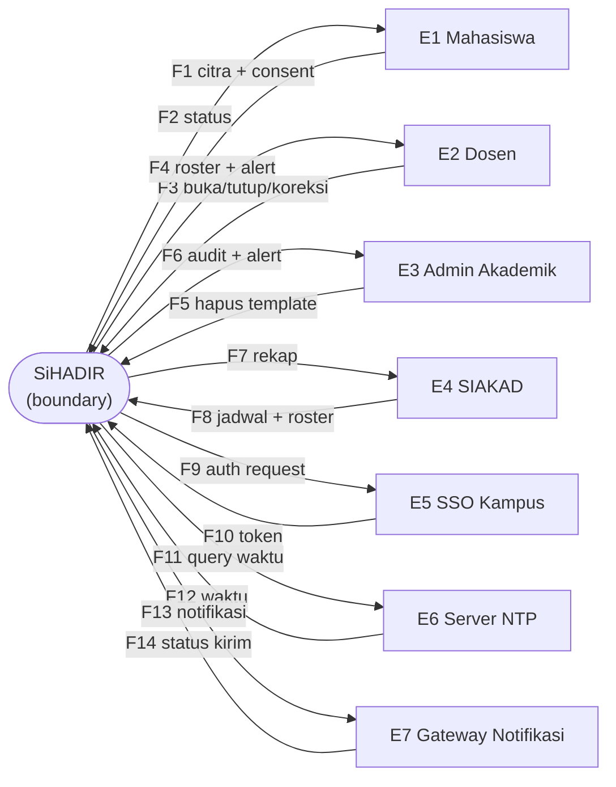

# S2 — Overview, Problem, Scope, Boundary, Context
Proyek: SiHADIR · CCE61317 RSK · Kelompok Jhons

## 2.1 Identitas sistem
- Nama: SiHADIR (Sistem Informasi Kehadiran Digital Berbasis Wajah)
- Jenis: system-of-interest berupa terminal presensi (HW+SW) + layanan backend + antarmuka pengguna, terintegrasi ke SIAKAD.
- Tujuan: memverifikasi kehadiran fisik mahasiswa di kelas melalui pengenalan wajah + liveness, mencatat status Hadir/Terlambat/Alfa secara otomatis, dan mengirim rekap ke SIAKAD tanpa rekap manual dosen.

## 2.2 Problem statement
| # | Masalah | Kondisi saat ini | Dampak |
|---|---|---|---|
| P1 | Presensi manual memakan waktu pembelajaran | Dosen memanggil nama / mengedarkan daftar hadir (ASSUMPTION A-06: 5–10 menit per sesi) | 5–10% waktu kuliah 100 menit terpakai; antrean di pintu |
| P2 | Titip absen tidak terdeteksi | Verifikasi identitas hanya nominal (nama dipanggil/dicentang) | Integritas kehadiran tidak dapat dipertanggungjawabkan |
| P3 | Rekap manual lambat dan tidak terintegrasi | Dosen merekap manual, diserahkan ke akademik | Rekap tidak seragam, rawan salah, tidak ada audit trail |
| P4 | Tidak ada verifikasi kehadiran fisik dan dasar consent | Tidak ada liveness; pengumpulan biometrik tanpa consent eksplisit | Foto/layar ponsel dapat menipu sistem; risiko pelanggaran UU PDP |

## 2.3 Tujuan terukur (MOE)
| MOE | Pernyataan | Ambang |
|---|---|---|
| MOE-1 | Waktu verifikasi satu kelas | 40 mahasiswa ≤ 180 detik |
| MOE-2 | Ketahanan terhadap spoofing | APCER ≤ 5% pada 200 serangan; BPCER ≤ 5% |
| MOE-3 | Ketepatan waktu rekap ke SIAKAD | ≤ 10 menit setelah sesi ditutup |
| MOE-4 | Ketersediaan layanan | ≥ 99% pada 07.00–21.00 WIB |

## 2.4 Scope (konsisten dengan PRJ1)
**Di dalam sistem (IN):**
1. Terminal presensi: kamera/webcam, laptop, perangkat lunak terminal.
2. Modul deteksi & pengenalan wajah (inferensi di terminal — A-02).
3. Modul liveness / anti-spoofing.
4. Basis data template wajah dan catatan sesi presensi.
5. Mesin aturan presensi (Hadir/Terlambat/Alfa).
6. Backend + API integrasi.
7. Antarmuka dosen (buka/tutup sesi, koreksi manual) dan konsol admin.
8. Modul enrolment wajah + pencatatan consent + audit log.

**Di luar sistem (OUT):**
1. SIAKAD (pemilik jadwal, daftar peserta, nilai).
2. Gateway notifikasi WhatsApp/e-mail.
3. SSO kampus dan server NTP.
4. Jaringan kampus, daya listrik, CCTV gedung.
5. Ponsel pribadi pengguna.
6. Kebijakan akademik dan UU PDP (batasan, bukan komponen).

## 2.5 External entities
| ID | Entitas | Jenis | Peran terhadap SiHADIR |
|---|---|---|---|
| E1 | Mahasiswa | Manusia | Melakukan presensi; memberi/menolak consent; menerima status |
| E2 | Dosen | Manusia | Membuka/menutup sesi; mengoreksi; memantau |
| E3 | Admin Akademik | Manusia | Menangani anomali; menghapus template; audit |
| E4 | SIAKAD | Sistem | Sumber jadwal & roster; penerima rekap |
| E5 | SSO Kampus | Sistem | Penyedia identitas (OIDC/SAML) |
| E6 | Server NTP | Sistem | Sumber waktu tepercaya |
| E7 | Gateway Notifikasi | Sistem | Pengirim WhatsApp/e-mail |

## 2.6 I/O context (level konteks)
| ID | Dari | Ke | Informasi / sinyal | Media | Timing |
|---|---|---|---|---|---|
| F1 | E1 | SiHADIR | Citra wajah live + keputusan consent | Kamera, layar sentuh/klik | Saat verifikasi/enrolment |
| F2 | SiHADIR | E1 | Status kehadiran / alasan penolakan | Layar terminal | ≤ 2 detik setelah verifikasi |
| F3 | E2 | SiHADIR | Perintah buka/tutup sesi, koreksi manual | UI dosen | Awal/akhir sesi, insidental |
| F4 | SiHADIR | E2 | Roster live, alert anomali, ringkasan sesi | UI dosen | Real-time |
| F5 | E3 | SiHADIR | Permintaan hapus template, tindak lanjut anomali | Konsol admin | Insidental |
| F6 | SiHADIR | E3 | Audit log, alert spoofing | Konsol admin | ≤ 30 detik setelah pemicu |
| F7 | SiHADIR | E4 | Rekap kehadiran terverifikasi | API | ≤ 10 menit setelah tutup sesi |
| F8 | E4 | SiHADIR | Jadwal + daftar peserta | API | Saat buka sesi / berkala |
| F9 | SiHADIR | E5 | Permintaan autentikasi | HTTPS (OIDC/SAML) | Saat login |
| F10 | E5 | SiHADIR | Token/assertion identitas | HTTPS | Saat login |
| F11 | SiHADIR | E6 | Query waktu | NTPv4 | ≤ setiap 15 menit |
| F12 | E6 | SiHADIR | Waktu tersinkron | NTPv4 | ≤ setiap 15 menit |
| F13 | SiHADIR | E7 | Payload notifikasi | HTTPS API | ≤ 60 detik setelah pemicu |
| F14 | E7 | SiHADIR | Status pengiriman | HTTPS API | Setelah kirim |

## 2.7 Posisi life-cycle (memperbaiki kontradiksi PRJ1)
SiHADIR berada pada **awal Engineering Development**, bukan Concept Development: buktinya prototipe end-to-end sudah berjalan (enrolment → encoding → rekap Excel). Namun artefak Concept Development (needs tervalidasi, ConOps, SRS, arsitektur) belum lengkap, sehingga **gate Concept→Engineering belum pernah ditutup secara formal**. Final Project ini berfungsi menutup gate tersebut sebelum desain rinci dilanjutkan.

## 2.8 Asumsi
- A-01 SIAKAD menyediakan API (REST/JSON atau SOAP).
- A-02 Inferensi wajah berjalan di terminal (edge), bukan di server.
- A-03 Satu sesi = satu kelas terjadwal, 40 mahasiswa/terminal.
- A-04 MATLAB R2024b+ dengan System Composer + Requirements Toolbox + Simulink.
- A-05 Identitas kelompok menggunakan `KelompokJhons` (Kelompok Jhons — Kelas B).
- A-06 Presensi manual saat ini 5–10 menit/sesi (butuh data lapangan).
- A-07 Setiap mahasiswa sudah punya identitas (NIM) di SIAKAD.
- A-08 Dosen dan admin memiliki akun SSO aktif.

## 2.9 Constraints
- C-01 UU PDP No. 27/2022: biometrik = data pribadi spesifik; wajib consent eksplisit, pembatasan tujuan, hak hapus.
- C-02 Status Hadir/Terlambat/Alfa dan ambang keterlambatan ditetapkan kebijakan akademik; sistem hanya menjalankan konfigurasi.
- C-03 Jaringan kampus tidak dijamin; sesi harus tetap berjalan saat offline.
- C-04 Perangkat: laptop dosen + webcam USB 720p, tanpa GPU khusus.
- C-05 Antarmuka SIAKAD dibatasi API yang disediakan pengelola SIAKAD.
- C-06 UI berbahasa Indonesia, waktu WIB, mengikuti kalender akademik.

## 2.10 Context diagram

Caption: batas sistem mencakup terminal, modul pengenalan/liveness, basis data, backend, dan UI; SIAKAD, SSO, NTP, gateway, serta infrastruktur berada di luar dan dihubungkan melalui antarmuka F7–F14.
