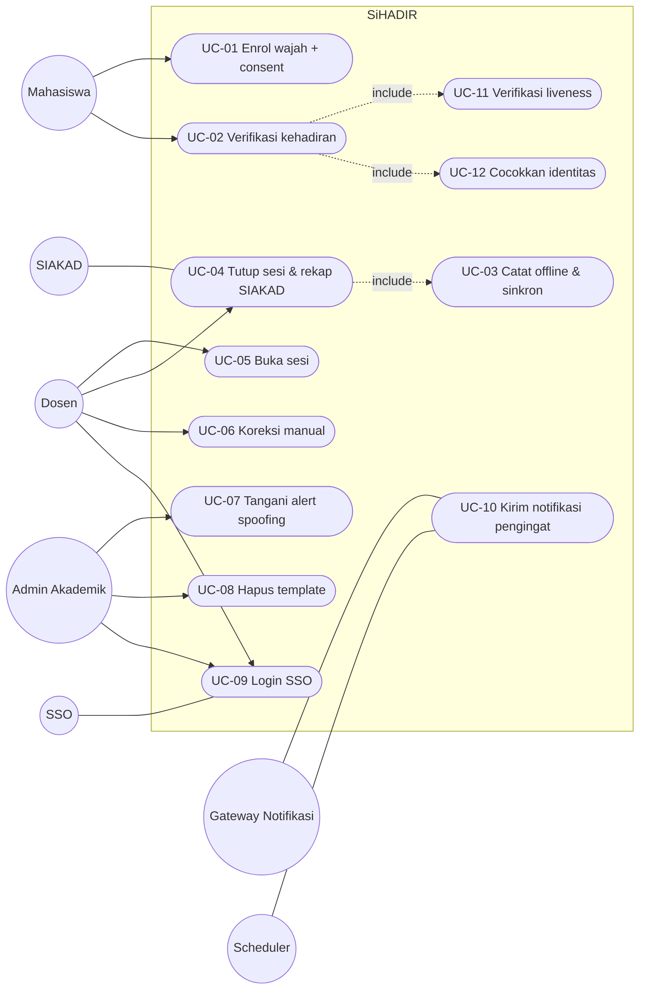
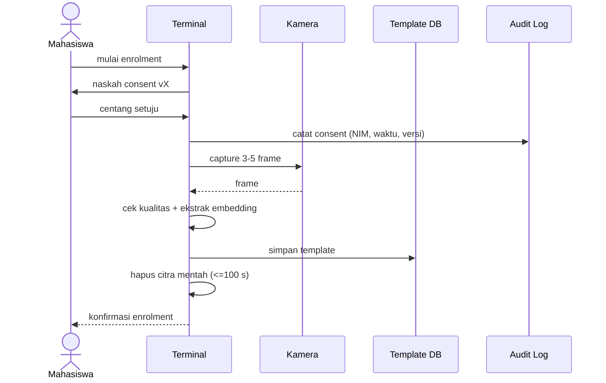
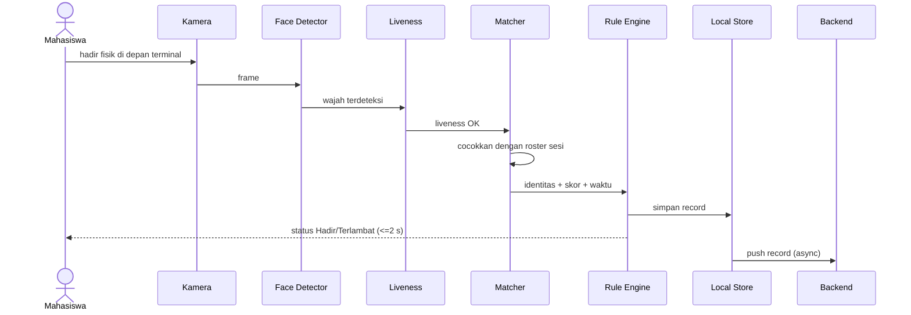
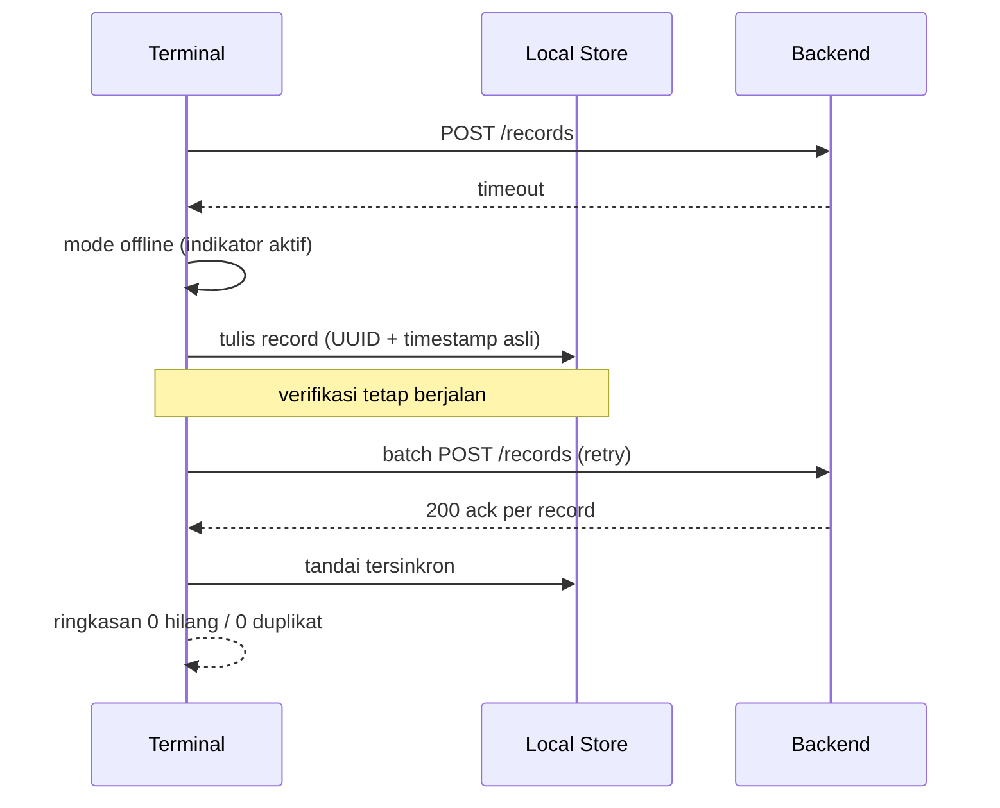
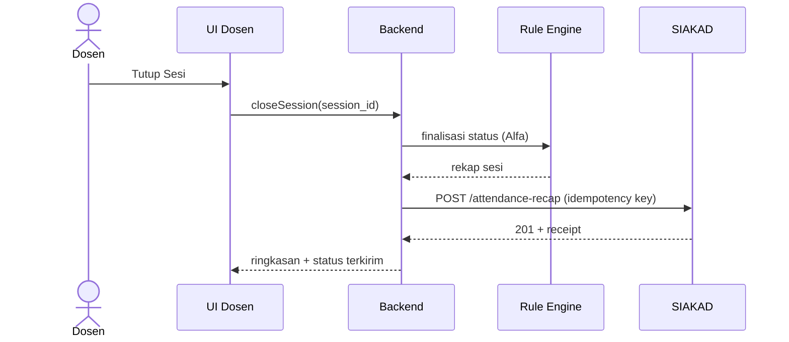

# S4 — Use Case & Sequence Diagram

## 4.1 Aktor
| Aktor | Jenis | Use case utama |
|---|---|---|
| Mahasiswa | Primer | UC-01, UC-02 |
| Dosen | Primer | UC-04, UC-05, UC-06 |
| Admin Akademik | Primer | UC-07, UC-08 |
| SIAKAD | Sekunder (sistem) | UC-04 |
| Gateway Notifikasi | Sekunder (sistem) | UC-10 |
| Scheduler (waktu) | Sekunder (sistem) | UC-10 |
| SSO Kampus | Sekunder (sistem) | UC-09 |

## 4.2 Use case diagram

Caption: garis putus-putus = `<<include>>`; aktor sistem di kanan adalah aktor sekunder.

## 4.3 UC-01 Enrol Wajah dengan Consent
| Item | Isi |
|---|---|
| Aktor primer / sekunder | Mahasiswa / Admin Akademik (pengawasan) |
| SN terkait | SN-04, SN-02, SN-01 |
| Requirement | SR-FR13, SR-SEC1, SR-SEC2, SR-SEC3 |
| Trigger | Mahasiswa memulai enrolment di terminal (jadwal enrolment atau atas arahan admin) |
| Pre-condition | Mahasiswa terdaftar di SIAKAD (A-07); belum ada template aktif atau sedang memperbarui; naskah consent versi terkini tersedia |
| Post-condition sukses | Template aktif tersimpan; consent tercatat (NIM, waktu, versi naskah); citra mentah terhapus ≤100 s |
| Post-condition gagal | Tidak ada template setengah jadi; penolakan consent tercatat di audit |

**Main flow**
1. Sistem menampilkan naskah consent versi X beserta tujuan, retensi, dan hak hapus.
2. Mahasiswa mencentang "setuju".
3. Sistem mencatat consent ke audit log.
4. Sistem meminta mahasiswa memposisikan wajah pada area tangkap.
5. Sistem menangkap 3–5 frame dan memeriksa kualitas (blur, pencahayaan, tepat satu wajah).
6. Sistem mengekstrak embedding dan membentuk template.
7. Sistem menyimpan template dan menghapus citra mentah.
8. Sistem menampilkan konfirmasi.

**Alternative flow**
- A1 (kualitas gagal): sistem menampilkan panduan perbaikan; ulangi langkah 4–5 maksimal 3 kali.
- A2 (consent ditolak): enrolment dibatalkan; tidak ada template; kejadian dicatat; mahasiswa tetap dapat hadir melalui koreksi manual dosen (UC-06).

**Exception / failure**
- E1 kamera tidak terdeteksi → pesan + status terminal *not ready* (SR-OPS2).
- E2 penyimpanan gagal → rollback transaksi, tidak ada template parsial.

**Kebutuhan khusus:** durasi ≤60 s per mahasiswa (A-11); UI berbahasa Indonesia (C-06).

## 4.4 UC-02 Verifikasi Kehadiran dengan Liveness
| Item | Isi |
|---|---|
| Aktor primer / sekunder | Mahasiswa / Dosen (memantau) |
| SN terkait | SN-01, SN-02 |
| Requirement | SR-FR1, SR-FR2, SR-FR3, SR-FR4, SR-FR5, SR-FR6, SR-FR15, SR-PRF1, SR-PRF2, SR-PRF3, SR-PRF4, SR-PRF5 |
| Trigger | Mahasiswa berdiri di depan terminal saat sesi berstatus OPEN |
| Pre-condition | Sesi OPEN; roster sesi tersedia (online atau cache); template aktif ada; jam terminal tersinkron |
| Post-condition sukses | Satu record kehadiran tersimpan (lokal + backend), status ditampilkan ≤2 s, audit tercatat |
| Post-condition gagal | Tidak ada record; percobaan tercatat; jika memenuhi ambang, alert spoofing dikirim |

**Main flow**
1. Kamera aktif; sistem mendeteksi wajah dalam area tangkap.
2. Sistem memverifikasi liveness (kedipan/gerak/tekstur kulit).
3. Jika live, sistem mengekstrak embedding.
4. Sistem mencocokkan hanya terhadap template mahasiswa pada roster sesi aktif.
5. Jika skor ≥ ambang, sistem menentukan status (Hadir/Terlambat) berdasarkan waktu server.
6. Sistem menyimpan record (NIM, waktu, terminal, skor, status, sumber=auto) ke local store.
7. Sistem mengirim record ke backend secara asinkron.
8. Sistem menampilkan nama + status kepada mahasiswa.

**Alternative flow**
- A1 (liveness gagal): tolak verifikasi, tampilkan pesan; tambah penghitung percobaan; bila ≥3 dalam 5 menit → SR-FR12.
- A2 (tidak dikenali): tawarkan ulang maksimal 3 kali; jika tetap gagal, arahkan ke dosen untuk koreksi manual (UC-06).
- A3 (sudah tercatat): tampilkan "sudah tercatat"; tidak membuat record baru (idempoten).

**Exception / failure**
- E1 backend tidak terjangkau → record tetap disimpan lokal, status "tertunda sinkron" (SR-FR9).
- E2 offset jam >1 s → record diberi flag waktu tidak valid + alert ke dosen; record tidak dibuang.

**Kebutuhan khusus:** p95 ≤2 s (SR-PRF2); 40 mahasiswa ≤180 s (SR-PRF1); FAR ≤0,01% (SR-PRF3); FRR ≤3% (SR-PRF4); APCER/BPCER ≤5% (SR-PRF5).

## 4.5 UC-03 Catat Offline & Sinkronisasi
| Item | Isi |
|---|---|
| Aktor primer / sekunder | Dosen, Administrator Infrastruktur / Backend |
| SN terkait | SN-05 |
| Requirement | SR-FR9, SR-FR10, SR-OPS4, SR-IF1 |
| Trigger | Koneksi terminal→backend terputus saat sesi OPEN, atau pulih kembali |
| Pre-condition | Sesi OPEN; roster sudah di-cache; local store tersedia |
| Post-condition sukses | 0 record hilang, 0 duplikat; seluruh record tersinkron |
| Post-condition gagal | Record tetap di local store; kegagalan dilaporkan, tidak hilang diam-diam |

**Main flow**
1. Terminal mendeteksi kegagalan koneksi (timeout).
2. Terminal beralih ke mode offline dan menampilkan indikator.
3. Verifikasi tetap berjalan; setiap record ditulis ke local store dengan timestamp asli dan UUID.
4. Setelah koneksi pulih, terminal mengirim batch record (idempoten berdasarkan UUID).
5. Backend mengembalikan ack per record.
6. Terminal menandai record tersinkron dan menampilkan ringkasan.

**Alternative flow**
- A1 (record sudah ada di backend): backend mengabaikan duplikat, mengembalikan status "already exists".
- A2 (sebagian gagal): retry dengan backoff; sisa kegagalan dilaporkan ke dosen/admin.

**Exception / failure**
- E1 local store penuh → verifikasi baru ditolak dengan pesan jelas + alert (bukan kehilangan data senyap).
- E2 perangkat mati saat offline → record yang sudah ditulis tetap ada (write-ahead).

**Kebutuhan khusus:** mampu offline ≥60 menit (SR-OPS4); sinkron ≤5 menit setelah pulih (kriteria SR-FR10).

## 4.6 UC-04 Tutup Sesi & Rekap ke SIAKAD
| Item | Isi |
|---|---|
| Aktor primer / sekunder | Dosen / SIAKAD, Gateway Notifikasi |
| SN terkait | SN-03, SN-06, SN-13 |
| Requirement | SR-FR8, SR-FR11, SR-FR14, SR-PRF6, SR-IF2 |
| Trigger | Dosen menekan "Tutup Sesi" atau jadwal sesi berakhir |
| Pre-condition | Sesi OPEN; record tersedia (tersinkron atau di local store) |
| Post-condition sukses | Rekap diterima SIAKAD ≤10 menit; status sesi CLOSED; audit tercatat |
| Post-condition gagal | Rekap tersimpan dan ditandai "pending"; admin mendapat alert |

**Main flow**
1. Dosen menekan "Tutup Sesi"; sistem meminta konfirmasi.
2. Sistem menolak verifikasi baru.
3. Sistem menetapkan Alfa bagi mahasiswa yang belum tercatat.
4. Sistem menyusun rekap (NIM, status, waktu, sumber auto/manual).
5. Sistem mengirim rekap ke SIAKAD dengan kunci idempotensi `session_id`.
6. SIAKAD mengembalikan ack + receipt.
7. Sistem menampilkan ringkasan dan status pengiriman.

**Alternative flow**
- A1 (record belum tersinkron): sistem menyelesaikan sinkronisasi (UC-03) sebelum menyusun rekap.
- A2 (SIAKAD menolak validasi): tampilkan pesan, simpan rekap, alert admin.

**Exception / failure**
- E1 SIAKAD tidak tersedia → retry hingga 10 menit; setelah itu eskalasi + status pending.
- E2 sesi ditutup tanpa sengaja → pembukaan kembali hanya oleh admin, tercatat di audit (SN-07).

**Kebutuhan khusus:** ≤10 menit setelah tutup (SR-PRF6); notifikasi pengingat dikirim 10 menit sebelum tutup (SR-FR11).

## 4.7 Sequence diagram

### SD-01 Enrolment + consent

### SD-02 Verifikasi kehadiran + liveness

### SD-03 Offline → sinkronisasi

### SD-04 Tutup sesi → rekap SIAKAD

## 4.8 ASSUMPTION
- A-11: enrolment ≤60 detik per mahasiswa.
- A-12: mahasiswa tidak login; identifikasi dilakukan lewat wajah, bukan akun.
- A-13: pembukaan kembali sesi yang sudah ditutup hanya oleh Admin Akademik (bukan dosen).
