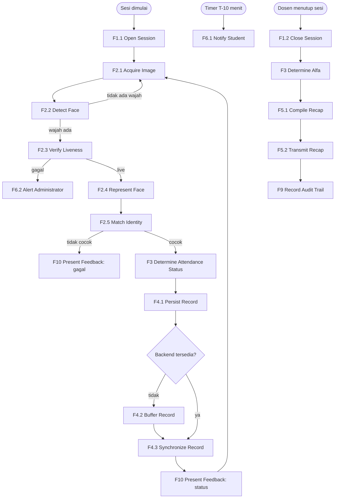

# S6 — Functional Architecture

## 6.1 Konvensi
- Nama fungsi = **verb–object**, tanpa teknologi (teknologi muncul di S7 sebagai komponen/mechanism).
- Notasi: IDEF0 (Input, Control, Output, Mechanism) untuk setiap fungsi; FFD untuk urutan; dekomposisi maksimal 2 level.
- Setiap fungsi wajib memenuhi ≥1 requirement; setiap requirement wajib dipenuhi ≥1 fungsi.

## 6.2 Dekomposisi fungsi

```mermaid
flowchart TD
  A0["A0 Verify Classroom Attendance"]
  A0 --> F1["F1 Manage Session"]
  A0 --> F2["F2 Verify Presence"]
  A0 --> F3["F3 Determine Attendance Status"]
  A0 --> F4["F4 Record Attendance"]
  A0 --> F5["F5 Report Attendance"]
  A0 --> F6["F6 Notify Stakeholders"]
  A0 --> F7["F7 Manage Identity Data"]
  A0 --> F8["F8 Control Access"]
  A0 --> F9["F9 Record Audit Trail"]
  A0 --> F10["F10 Present Feedback"]
  A0 --> F11["F11 Monitor Readiness"]
  A0 --> F12["F12 Synchronize Time"]

  F1 --> F1a["F1.1 Open Session"]
  F1 --> F1b["F1.2 Close Session"]
  F2 --> F2a["F2.1 Acquire Image"]
  F2 --> F2b["F2.2 Detect Face"]
  F2 --> F2c["F2.3 Verify Liveness"]
  F2 --> F2d["F2.4 Represent Face"]
  F2 --> F2e["F2.5 Match Identity"]
  F4 --> F4a["F4.1 Persist Record"]
  F4 --> F4b["F4.2 Buffer Record"]
  F4 --> F4c["F4.3 Synchronize Record"]
  F5 --> F5a["F5.1 Compile Recap"]
  F5 --> F5b["F5.2 Transmit Recap"]
  F6 --> F6a["F6.1 Notify Student"]
  F6 --> F6b["F6.2 Alert Administrator"]
  F7 --> F7a["F7.1 Capture Consent"]
  F7 --> F7b["F7.2 Enrol Template"]
  F7 --> F7c["F7.3 Erase Biometric Data"]
  F8 --> F8a["F8.1 Authenticate User"]
  F8 --> F8b["F8.2 Authorize Role"]
```

## 6.3 IDEF0 (ICOM) — level 1
| ID | Fungsi | Input | Control | Output | Mechanism (generik) |
|---|---|---|---|---|---|
| F1 | Manage Session | Perintah dosen, jadwal sesi | Kewenangan akademik, status sesi | Sesi aktif/tertutup, roster | UI dosen, layanan sesi |
| F2 | Verify Presence | Subjek di area tangkap | Ambang kemiripan, kebijakan liveness | Identitas terverifikasi + skor | Sensor optik, unit komputasi |
| F3 | Determine Attendance Status | Identitas, waktu, jendela waktu | Aturan Hadir/Terlambat/Alfa | Status kehadiran | Mesin aturan |
| F4 | Record Attendance | Status + metadata | Skema record, idempotensi | Record tersimpan | Penyimpanan lokal & backend |
| F5 | Report Attendance | Record sesi | Format SIAKAD, idempotency key | Rekap terkirim + ack | Layanan rekap, kanal integrasi |
| F6 | Notify Stakeholders | Pemicu, daftar penerima | Template pesan, kebijakan notifikasi | Pesan terkirim | Gateway notifikasi |
| F7 | Manage Identity Data | Data biometrik, persetujuan | UU PDP, kebijakan retensi | Template / penghapusan | Modul enrolment, basis data |
| F8 | Control Access | Kredensial, token | Matriks peran | Sesi terautentikasi | SSO, layanan otorisasi |
| F9 | Record Audit Trail | Event sistem | Skema audit, append-only | Entri audit | Penyimpanan audit |
| F10 | Present Feedback | Hasil verifikasi/status | Aturan tampilan | Tampilan ke pengguna | Layar terminal, UI |
| F11 | Monitor Readiness | Status subsistem | Kriteria "siap" | Status siap/tidak siap | Prosedur self-test |
| F12 | Synchronize Time | Waktu referensi | Interval & toleransi | Waktu tersinkron | Klien NTP |

## 6.4 IDEF0 — level 2 (leaf)
| ID | Fungsi | Input | Control | Output | Mechanism |
|---|---|---|---|---|---|
| F1.1 | Open Session | Sesi terjadwal, perintah buka | Kewenangan dosen | Sesi OPEN + roster | UI dosen, integrasi/cache |
| F1.2 | Close Session | Perintah tutup | Aturan penutupan | Sesi CLOSED, daftar Alfa | UI dosen, mesin aturan |
| F2.1 | Acquire Image | Cahaya ruang | Konfigurasi capture | Frame | Sensor optik |
| F2.2 | Detect Face | Frame | Model deteksi, area tangkap | Bounding box wajah | Unit komputasi |
| F2.3 | Verify Liveness | Urutan frame wajah | Ambang liveness | Keputusan live/spoof | Unit komputasi |
| F2.4 | Represent Face | Wajah live | Model representasi | Vektor fitur | Unit komputasi |
| F2.5 | Match Identity | Vektor fitur, roster | Ambang kemiripan | Kandidat + skor | Basis data template |
| F4.1 | Persist Record | Status + metadata | Skema record | Record tersimpan | Penyimpanan |
| F4.2 | Buffer Record | Record saat offline | Kapasitas, retensi | Record lokal + UUID | Penyimpanan lokal |
| F4.3 | Synchronize Record | Record tertunda, koneksi | Idempotensi, backoff | Record tersinkron + ack | Kanal jaringan |
| F5.1 | Compile Recap | Record sesi, roster | Aturan rekap | Rekap sesi | Mesin rekap |
| F5.2 | Transmit Recap | Rekap sesi | Kontrak API, idempotency | Ack + receipt | Kanal ke SIAKAD |
| F6.1 | Notify Student | Daftar belum tercatat, pemicu T-10 | Template pesan | Pesan terkirim | Gateway |
| F6.2 | Alert Administrator | Ambang spoofing | Aturan eskalasi | Alert di konsol | Gateway/kanal internal |
| F7.1 | Capture Consent | Naskah consent, keputusan | UU PDP | Bukti consent | UI enrolment |
| F7.2 | Enrol Template | Frame wajah, NIM | Kualitas capture | Template | Modul enrolment, basis data |
| F7.3 | Erase Biometric Data | Permintaan hapus | Kebijakan retensi | Data terhapus + audit | Basis data, audit log |
| F8.1 | Authenticate User | Kredensial | Kebijakan SSO | Token valid | SSO kampus |
| F8.2 | Authorize Role | Token, peran | Matriks peran | Izin akses | Layanan otorisasi |
| F9 | Record Audit Trail | Event | Append-only | Entri audit | Penyimpanan audit |
| F10 | Present Feedback | Hasil/status | Aturan tampilan | Tampilan | Layar/UI |
| F11 | Monitor Readiness | Status subsistem | Kriteria siap | Status | Self-test |
| F12 | Synchronize Time | Waktu referensi | Interval 15 mnt, toleransi 1 s | Waktu tersinkron | Klien NTP |

## 6.5 FFD — alur fungsi utama

## 6.6 Matriks fungsi ↔ requirement
| Fungsi | Requirement yang dipenuhi |
|---|---|
| F1.1 | SR-FR7 |
| F1.2 | SR-FR8 |
| F2 (agregat) | SR-PRF1 |
| F2.1 | SR-OPS3 |
| F2.2 | SR-FR1 |
| F2.3 | SR-FR2, SR-PRF5 |
| F2.4 | SR-FR3 |
| F2.5 | SR-FR3, SR-FR4, SR-PRF3, SR-PRF4 |
| F3 | SR-FR6 |
| F4 (agregat) | SR-OPS1 |
| F4.1 | SR-FR5 |
| F4.2 | SR-FR9, SR-OPS4 |
| F4.3 | SR-FR10, SR-IF1 |
| F5 (agregat) | SR-OPS1 |
| F5.1 | SR-FR14 |
| F5.2 | SR-FR14, SR-PRF6, SR-IF2 |
| F6.1 | SR-FR11, SR-IF5 |
| F6.2 | SR-FR12 |
| F7.1 | SR-SEC1 |
| F7.2 | SR-FR13, SR-SEC2 |
| F7.3 | SR-SEC3 |
| F8.1 | SR-IF3 |
| F8.2 | SR-SEC4 |
| F9 | SR-SEC5 |
| F10 | SR-FR15, SR-IF6, SR-PRF2 |
| F11 | SR-OPS2 |
| F12 | SR-FR5, SR-IF4 |

## 6.7 Cek kelengkapan
- Fungsi tanpa requirement: **0** (semua 27 node punya ≥1 requirement).
- Requirement tanpa fungsi: **0** (36/36 terpetakan).
- SR-OPS1 dialokasikan ke dua fungsi agregat (F4, F5) karena ketersediaan adalah properti layanan, bukan satu fungsi tunggal.

## 6.8 ASSUMPTION
- A-16: "Record" mencakup kehadiran otomatis dan koreksi manual; koreksi manual memakai fungsi F4.1 dengan atribut sumber.
- A-17: F9 (audit) dipanggil oleh fungsi lain sebagai layanan lintas-potong, bukan hanya di akhir sesi.
