# S7 — Physical Architecture

## 7.1 Prinsip dekomposisi
- Subsistem dipisah berdasarkan **laju perubahan** dan **batas kepercayaan** (trust boundary), bukan berdasarkan teknologi.
- Terminal = zona tidak tepercaya (fisik dapat diakses mahasiswa) → verifikasi & buffer lokal.
- Backend = zona tepercaya → aturan, integrasi, audit.
- Data dipisah dari layanan agar retensi/penghapusan biometrik dapat dilakukan tanpa menghentikan layanan.

## 7.2 Struktur sistem

```mermaid
flowchart TB
  subgraph SYS["SiHADIR (system of interest)"]
    subgraph S1["S1 Edge Terminal"]
      C11["C1.1 Camera (HW)"]
      C12["C1.2 Compute Unit (HW)"]
      C13["C1.3 Terminal Application (SW)"]
      C14["C1.4 Face Detection & Recognition (SW/ML)"]
      C15["C1.5 Liveness Engine (SW/ML)"]
      C16["C1.6 Local Record Store (SW)"]
      C17["C1.7 Roster & Template Cache (SW)"]
      C18["C1.8 Display (HW/SW)"]
      C19["C1.9 Sync Agent (SW)"]
      C110["C1.10 Time Client (SW)"]
      C111["C1.11 Readiness Monitor (SW)"]
    end
    subgraph S2["S2 Backend Services"]
      C21["C2.1 API Gateway"]
      C22["C2.2 Session Service"]
      C23["C2.3 Attendance Service"]
      C24["C2.4 Rule Engine"]
      C25["C2.5 Recap Service"]
      C26["C2.6 Notification Service"]
      C27["C2.7 Audit Service"]
      C28["C2.8 Access Control Service"]
    end
    subgraph S3["S3 Integration & Comms"]
      C31["C3.1 SIAKAD Connector"]
      C32["C3.2 Notification Connector"]
      C33["C3.3 SSO Connector"]
    end
    subgraph S4["S4 Data Management"]
      C41["C4.1 Template DB"]
      C42["C4.2 Attendance DB"]
      C43["C4.3 Audit Store"]
      C44["C4.4 Consent Registry"]
    end
    subgraph S5["S5 User Interfaces"]
      C51["C5.1 Lecturer UI"]
      C52["C5.2 Admin Console"]
      C53["C5.3 Enrolment UI"]
    end
    subgraph S6["S6 Identity & Privacy"]
      C61["C6.1 Consent Module"]
      C62["C6.2 Enrolment Module"]
      C63["C6.3 Erasure Module"]
    end
  end

  E1(("E1 Mahasiswa"))
  E2(("E2 Dosen"))
  E3(("E3 Admin"))
  E4(("E4 SIAKAD"))
  E5(("E5 SSO"))
  E6(("E6 NTP"))
  E7(("E7 Gateway"))

  E1 --> C11
  C18 --> E1
  E2 --> C51
  C51 --> E2
  E3 --> C52
  C52 --> E3
  C13 -->|"IF-T2B HTTPS/REST"| C21
  C21 -->|"IF-B2S"| C31
  C31 --> E4
  E4 --> C31
  C28 -->|"IF-B2SSO"| C33
  C33 --> E5
  C26 -->|"IF-B2GW"| C32
  C32 --> E7
  C110 -->|"IF-T2NTP"| E6
  C51 -->|"IF-UI2B"| C21
  C52 -->|"IF-UI2B"| C21
```

## 7.3 Komponen & tanggung jawab
| ID | Komponen | Jenis | Tanggung jawab | Fungsi dihost |
|---|---|---|---|---|
| C1.1 | Camera | HW | Menangkap frame | F2.1 |
| C1.2 | Compute Unit | HW | Menjalankan SW terminal | host F2.2–F2.5, F4.2 |
| C1.3 | Terminal Application | SW | Orkestrasi alur verifikasi & penetapan status di terminal | F3, F10 |
| C1.4 | Face Detection & Recognition | SW/ML | Deteksi, representasi, pencocokan | F2.2, F2.4, F2.5 |
| C1.5 | Liveness Engine | SW/ML | Uji keaslian subjek | F2.3 |
| C1.6 | Local Record Store | SW/data | Buffer record saat offline | F4.2 |
| C1.7 | Roster & Template Cache | SW/data | Menyimpan roster & template sesi aktif | F1.1, F2.5 |
| C1.8 | Display | HW/SW | Umpan balik ke mahasiswa | F10 |
| C1.9 | Sync Agent | SW | Sinkronisasi record | F4.3 |
| C1.10 | Time Client | SW | Sinkronisasi waktu | F12 |
| C1.11 | Readiness Monitor | SW | Self-test terminal | F11 |
| C2.1 | API Gateway | SW | Titik masuk, enforcement otorisasi | F8.2 |
| C2.2 | Session Service | SW | Buka/tutup sesi | F1.1, F1.2 |
| C2.3 | Attendance Service | SW | Menyimpan record | F4.1 |
| C2.4 | Rule Engine | SW | Menetapkan status | F3 |
| C2.5 | Recap Service | SW | Menyusun rekap | F5.1 |
| C2.6 | Notification Service | SW | Menjadwalkan & mengirim notifikasi | F6.1, F6.2 |
| C2.7 | Audit Service | SW | Mencatat event | F9 |
| C2.8 | Access Control Service | SW | Autentikasi & otorisasi | F8.1 |
| C3.1 | SIAKAD Connector | SW | Kontrak API SIAKAD | F5.2 |
| C3.2 | Notification Connector | SW | Kontrak gateway | F6.1 |
| C3.3 | SSO Connector | SW | Kontrak OIDC/SAML | F8.1 |
| C4.1 | Template DB | Data | Menyimpan template | dukung F2.5, F7.2 |
| C4.2 | Attendance DB | Data | Menyimpan record & rekap | dukung F4.1, F5.1 |
| C4.3 | Audit Store | Data | Append-only | dukung F9 |
| C4.4 | Consent Registry | Data | Bukti consent | dukung F7.1 |
| C5.1 | Lecturer UI | SW | Buka/tutup, pantau, koreksi | F1.1, F1.2, F10 |
| C5.2 | Admin Console | SW | Anomali, hapus template, audit | F6.2, F7.3 |
| C5.3 | Enrolment UI | SW | Alur enrolment | F7.1, F7.2 |
| C6.1 | Consent Module | SW | Menampilkan & mencatat consent | F7.1 |
| C6.2 | Enrolment Module | SW | Membentuk template | F7.2 |
| C6.3 | Erasure Module | SW | Menghapus data biometrik | F7.3 |

## 7.4 Port & antarmuka komponen (lengkap 100 port pada 32 komponen)
| Komponen | Port (`arah : interface`) |
|---|---|
| C1.1 Camera | `camOut` (out : `IF-I1`) |
| C1.2 Compute Unit | `statusOut` (out : `internal`) |
| C1.3 Terminal Application | `camIn` (in : `IF-I1`), `matchIn` (in : `IF-I3`), `liveIn` (in : `internal`), `readyIn` (in : `internal`), `timeIn` (in : `internal`), `embedIn` (in : `IF-I2`), `frameOut` (out : `IF-I2`), `liveFrameOut` (out : `IF-I1`), `recordOut` (out : `IF-I4`), `apiOut` (out : `IF-T2B`), `displayOut` (out : `IF-I4`), `enrolOut` (out : `IF-T2B`) |
| C1.4 Face Detection & Recognition | `frameIn` (in : `IF-I2`), `tplIn` (in : `IF-I9`), `matchOut` (out : `IF-I3`), `embedOut` (out : `IF-I2`) |
| C1.5 Liveness Engine | `frameIn` (in : `IF-I1`), `liveOut` (out : `internal`) |
| C1.6 Local Record Store | `storeIn` (in : `IF-I4`), `storeOut` (out : `IF-I4`) |
| C1.7 Roster & Template Cache | `rosterIn` (in : `IF-I9`), `tplOut` (out : `IF-I9`) |
| C1.8 Display | `dispIn` (in : `IF-I4`) |
| C1.9 Sync Agent | `syncIn` (in : `IF-I4`), `syncOut` (out : `IF-T2B`) |
| C1.10 Time Client | `ntpOut` (out : `IF-T2NTP`), `timeOut` (out : `internal`) |
| C1.11 Readiness Monitor | `statusIn` (in : `internal`), `readyOut` (out : `internal`) |
| C2.1 API Gateway | `termIn` (in : `IF-T2B`), `syncIn` (in : `IF-T2B`), `uiIn` (in : `IF-UI2B`), `uiInAdmin` (in : `IF-UI2B`), `authIn` (in : `internal`), `enrolIn` (in : `IF-T2B`), `consentIn` (in : `IF-I10`), `apiOut` (out : `internal`), `cmdOut` (out : `IF-UI2B`), `enrolOut` (out : `IF-T2B`), `eraseOut` (out : `IF-UI2B`), `viewOut` (out : `IF-UI2B`), `auditOut` (out : `IF-I7`), `consentOut` (out : `IF-I10`) |
| C2.2 Session Service | `cmdIn` (in : `IF-UI2B`), `tplIn` (in : `IF-I9`), `rosterOut` (out : `IF-I9`), `sessionOut` (out : `internal`), `timerOut` (out : `internal`) |
| C2.3 Attendance Service | `recIn` (in : `internal`), `statusIn` (in : `IF-I8`), `recOut` (out : `IF-I5`), `doneOut` (out : `internal`), `evtOut` (out : `internal`), `auditOut` (out : `IF-I7`) |
| C2.4 Rule Engine | `closeIn` (in : `internal`), `statusOut` (out : `IF-I8`) |
| C2.5 Recap Service | `recapIn` (in : `IF-I6`), `trigIn` (in : `internal`), `recapOut` (out : `IF-B2S`) |
| C2.6 Notification Service | `trigIn` (in : `internal`), `evtIn` (in : `internal`), `pendingIn` (in : `IF-I6`), `notifyOut` (out : `IF-B2GW`), `alertOut` (out : `IF-UI2B`) |
| C2.7 Audit Service | `auditGwIn` (in : `IF-I7`), `auditAttIn` (in : `IF-I7`), `auditConsentIn` (in : `IF-I7`), `auditEraseIn` (in : `IF-I7`), `auditOut` (out : `IF-I7`) |
| C2.8 Access Control Service | `ssoOut` (out : `IF-B2SSO`), `tokenOut` (out : `internal`) |
| C3.1 SIAKAD Connector | `recapIn` (in : `IF-B2S`), `recapOut` (out : `IF-B2S`) |
| C3.2 Notification Connector | `notifyIn` (in : `IF-B2GW`), `notifyOut` (out : `IF-B2GW`) |
| C3.3 SSO Connector | `authIn` (in : `IF-B2SSO`), `authOut` (out : `IF-B2SSO`) |
| C4.1 Template DB | `tplIn` (in : `internal`), `tplStoreIn` (in : `IF-T2B`), `tplOut` (out : `IF-I9`) |
| C4.2 Attendance DB | `recIn` (in : `IF-I5`), `recapOut` (out : `IF-I6`), `pendingOut` (out : `IF-I6`) |
| C4.3 Audit Store | `auditIn` (in : `IF-I7`) |
| C4.4 Consent Registry | `consentIn` (in : `IF-I10`) |
| C5.1 Lecturer UI | `viewIn` (in : `IF-UI2B`), `uiOut` (out : `IF-UI2B`) |
| C5.2 Admin Console | `alertIn` (in : `IF-UI2B`), `uiOut` (out : `IF-UI2B`) |
| C5.3 Enrolment UI | `consentOut` (out : `IF-I10`) |
| C6.1 Consent Module | `consentIn` (in : `IF-I10`), `consentOut` (out : `IF-I10`), `auditOut` (out : `IF-I7`) |
| C6.2 Enrolment Module | `tplIn` (in : `IF-T2B`), `tplOut` (out : `IF-T2B`) |
| C6.3 Erasure Module | `eraseIn` (in : `IF-UI2B`), `tplDelOut` (out : `internal`), `auditOut` (out : `IF-I7`) |

## 7.5 Trade study 1 — lokasi inferensi (edge vs server vs hybrid)
Bobot: latency 0,30 · offline 0,25 · privacy 0,20 · cost 0,15 · scalability 0,10 (skala 1–5).

| Kriteria | Bobot | Edge | Server | Hybrid |
|---|---|---|---|---|
| Latency | 0,30 | 5 | 3 | 4 |
| Offline | 0,25 | 5 | 1 | 2 |
| Privacy | 0,20 | 4 | 2 | 3 |
| Cost | 0,15 | 4 | 3 | 3 |
| Scalability | 0,10 | 2 | 5 | 4 |
| **Skor** | | **4,35** | **2,50** | **3,15** |

**Sensitivitas:** jika bobot offline diturunkan ke 0 dan scalability dinaikkan ke 0,35, hybrid menang tipis (3,65 vs edge 3,60 vs server 3,50). Namun offline adalah **constraint keras** (C-03, SN-05), sehingga bobot 0,25 dipertahankan → **edge dipilih**.

## 7.6 Trade study 2 — metode liveness
Bobot: security/APCER 0,55 · UX/waktu 0,20 · biaya HW 0,15 · kelayakan CPU 0,10.

| Kriteria | Bobot | Passive | Active challenge | Hybrid |
|---|---|---|---|---|
| Security | 0,55 | 3 | 4 | 5 |
| UX/waktu | 0,20 | 5 | 2 | 3 |
| Biaya HW | 0,15 | 5 | 5 | 4 |
| Kelayakan CPU | 0,10 | 4 | 5 | 3 |
| **Skor** | | **3,80** | **3,85** | **4,25** |

**Keputusan:** hybrid — passive pada semua subjek, active challenge hanya bila skor keyakinan rendah (target ≤10% kasus), sehingga p95 tetap ≤2 s.

## 7.7 Justifikasi dekomposisi
| Keputusan | Alasan |
|---|---|
| Terminal terpisah dari backend | Trust boundary berbeda; terminal dapat disentuh fisik |
| Liveness dipisah dari recognition | Model & metrik berbeda (APCER vs FAR/FRR); dapat diganti independen |
| Rule engine dipisah dari attendance service | Aturan akademik berubah tanpa mengubah penyimpanan |
| Data dipisah dari layanan | Retensi & hak hapus biometrik tanpa downtime |
| Integration adapter per sistem eksternal | Kontrak eksternal berubah independen; isolasi kegagalan |
| Audit store append-only terpisah | Kebutuhan integritas & pemeriksaan auditor |
| Gateway sebagai satu-satunya pintu klien | Seluruh klien (terminal, UI dosen, UI admin, UI enrolment) wajib melewati `C2.1 API Gateway` setelah otorisasi `C2.8` |
| Time Client langsung ke NTP | `C1.10 Time Client` terhubung langsung ke server NTP eksternal (`E6`) sehingga terminal tidak bergantung pada backend untuk sinkronisasi waktu |

## 7.8 Catatan SPOF (detail di S8)
- C4.1 Template DB: satu instance → jika mati, verifikasi gagal total.
- C2.1 API Gateway: satu titik masuk.
- C3.1 SIAKAD Connector: ketergantungan eksternal (A-01).
- C1.2 Compute Unit: satu terminal per kelas; tidak ada redundansi.
- C1.10 Time Client: terhubung langsung ke NTP eksternal (`E6`) dan tidak bergantung pada backend; jika NTP gagal, terminal memakai jam monotonik + flag.

## 7.9 ASSUMPTION
- A-18: satu backend terpusat melayani seluruh terminal (bukan multi-region).
- A-19: model ML berjalan di CPU laptop; tidak ada GPU.
- A-20: database menggunakan satu instance primer tanpa replika.
