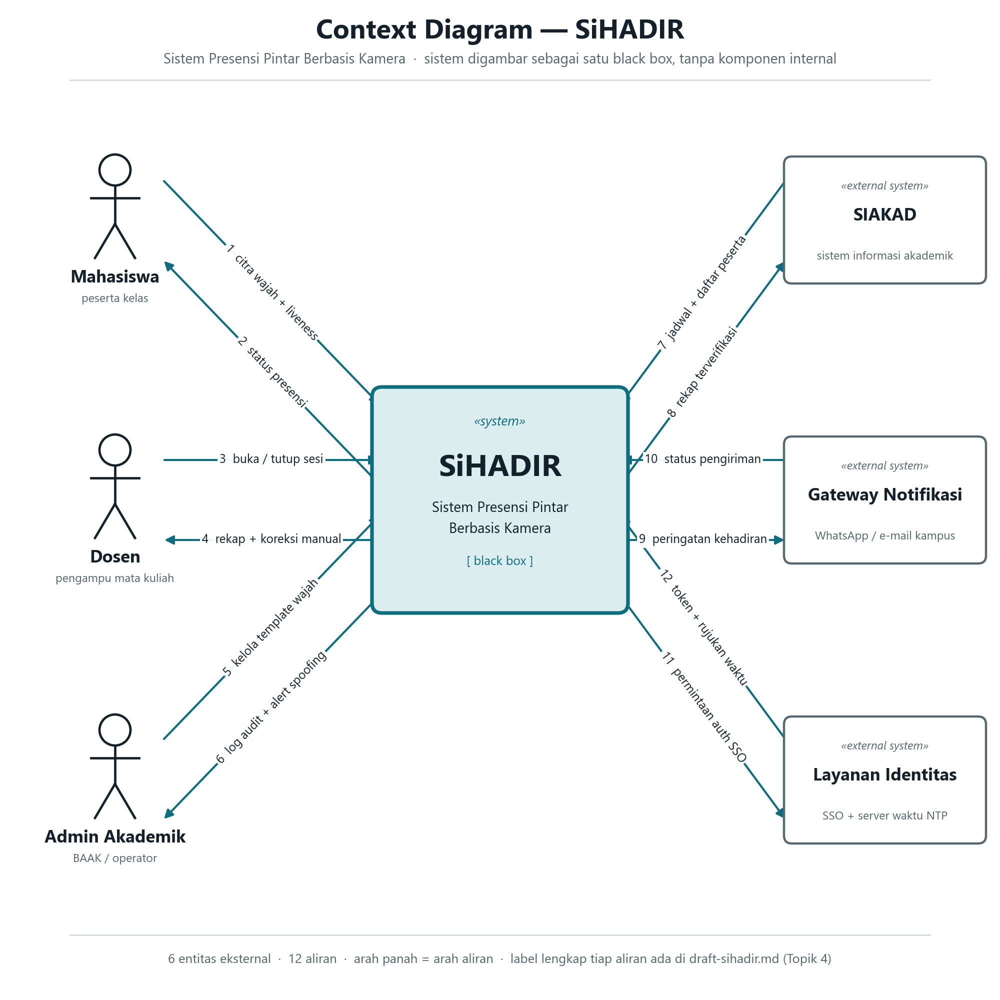

# Draf Tugas Systems Engineering — SiHADIR

**SiHADIR — Sistem Presensi Pintar Berbasis Kamera**

> **Cara pakai berkas ini**
>
> - Isinya disusun **per topik**, bukan per kotak slide. Ambil yang perlu, padatkan sendiri jadi maksimal 2 slide / 2 halaman.
> - Angka dan istilahnya sengaja konkret supaya gampang dipertahankan saat ditanya. Ganti kalau asumsi kampus kalian berbeda.
> - Nama "SiHADIR" bukan akronim, melainkan nama dari kata *hadir*. Kalau dosen menuntut kepanjangan: **Sistem Hadir Digital Ruang Kelas**. Alternatif netral: **SPPK** (Sistem Presensi Pintar berbasis Kamera).

Alur yang diminta tugas:

```
HAL 1  →  Nama Sistem  →  Tujuan  →  System Boundary  →  Context Diagram
HAL 2  →  Fase Saat Ini  →  Bukti/Artefak  →  Risiko  →  Langkah Berikutnya
```

---

# Halaman 1 — System Context

## Topik 1 — Nama sistem

**SiHADIR**
Sistem Presensi Pintar Berbasis Kamera

## Topik 2 — Tujuan singkat

Mengotomatiskan pencatatan kehadiran mahasiswa dan dosen di ruang kelas melalui pengenalan wajah, sehingga presensi tercatat cepat, tidak bisa dititipkan, dan langsung terkirim ke sistem akademik sebagai rekap resmi.

Tiga sasaran sebagai ukuran keberhasilan — bukan sekadar "lebih praktis":

1. Satu kelas 40 mahasiswa terverifikasi dalam **≤ 3 menit**, tanpa antrean menumpuk di pintu.
2. **Nol kasus titip absen** — dijamin oleh pemeriksaan liveness, bukan oleh kejujuran.
3. Rekap masuk ke SIAKAD **≤ 10 menit** setelah sesi ditutup, tanpa rekap manual dosen.

## Topik 3 — System boundary

**Di dalam sistem**

- Kamera perangkat presensi (webcam laptop atau kamera USB) dan laptop yang menjalankannya di ruang kelas
- Modul deteksi & pengenalan wajah (inferensi AI)
- Modul liveness / anti-spoofing (lawan foto dan video)
- Basis data template wajah dan catatan sesi presensi
- Mesin aturan presensi: jendela waktu, hadir / terlambat / alfa
- Layanan backend + API integrasi
- Antarmuka dosen (buka–tutup sesi, koreksi manual) dan konsol admin
- Modul enrolment wajah beserta pencatatan persetujuan

**Di luar sistem**

- SIAKAD — pemilik jadwal, daftar peserta, dan nilai
- Mahasiswa, dosen, admin akademik (aktor manusia)
- Gateway notifikasi WhatsApp / e-mail kampus
- SSO kampus dan server waktu (NTP)
- Jaringan kampus, daya listrik, dan CCTV keamanan gedung
- Ponsel pribadi pengguna
- Kebijakan akademik & UU PDP — batasan, bukan komponen

**Satu keputusan batas yang perlu disebut eksplisit**

Kamera yang dipakai adalah kamera perangkat presensi itu sendiri — webcam laptop yang dijalankan dosen atau operator di kelas — sehingga termasuk **di dalam** sistem. CCTV keamanan gedung tetap **di luar**: dikelola unit lain dan tidak dijadikan sumber presensi.

## Topik 4 — Context diagram



*Berkas: `context-diagram-sihadir.png` — 2000 × 2000 px, siap dimasukkan ke slide.*

Notasi mengikuti gaya UML: aktor manusia digambar sebagai *stick figure*, sistem eksternal sebagai kotak berstereotip «external system», dan SiHADIR sebagai satu kotak «system» tanpa isi. Arah panah menunjukkan arah aliran. Label di diagram sengaja disingkat; label lengkapnya ada di tabel berikut.

### Daftar aliran

12 aliran — tugas minta minimal 6.

| No | Dari → Ke | Label aliran |
|---:|---|---|
| 1 | Mahasiswa → Sistem | Citra wajah + isyarat liveness (kedip / gerak kepala) saat masuk ruang |
| 2 | Sistem → Mahasiswa | Konfirmasi status presensi di layar: Hadir / Terlambat 7 menit / Tidak dikenali |
| 3 | Dosen → Sistem | Perintah buka dan tutup sesi presensi pertemuan ke-*n* |
| 4 | Sistem → Dosen | Rekap kehadiran pertemuan + daftar wajah gagal verifikasi untuk dikoreksi manual |
| 5 | Admin Akademik → Sistem | Pendaftaran & pencabutan template wajah, serta aturan toleransi keterlambatan |
| 6 | Sistem → Admin Akademik | Log audit akses data biometrik + peringatan percobaan spoofing |
| 7 | SIAKAD → Sistem | Jadwal kuliah, kode ruang, dan daftar peserta kelas (NIM & NIDN) |
| 8 | Sistem → SIAKAD | Rekap presensi terverifikasi per NIM per pertemuan (status final) |
| 9 | Sistem → Gateway Notifikasi | Pesan peringatan kehadiran di bawah 75% ke mahasiswa dan dosen wali |
| 10 | Gateway Notifikasi → Sistem | Status pengiriman pesan (terkirim / gagal / nomor tidak aktif) |
| 11 | Sistem → Layanan Identitas | Permintaan autentikasi SSO untuk login dosen dan admin |
| 12 | Layanan Identitas → Sistem | Token identitas + peran pengguna, dan rujukan waktu NTP untuk stempel presensi |

### Aliran paling kritis

- **Aliran 7** — tanpa jadwal dan daftar peserta, sistem tidak tahu siapa yang seharusnya hadir; seluruh logika presensi runtuh.
- **Aliran 8** — satu-satunya keluaran yang bernilai akademik resmi. Kalau gagal, sistem tidak berguna.
- **Aliran 4** — jalur pemulihan saat AI salah kenali. Tanpa ini, kesalahan model langsung jadi sengketa nilai.

### Sengaja tidak digambar

Komponen **internal**, harus keluar dari context diagram:

- Webcam dan laptop yang menjalankannya
- Model / engine face recognition
- Database template wajah
- API server dan dashboard

---

# Halaman 2 — Life Cycle Analysis

## Topik 5 — Fase saat ini

```
[CONCEPT] → Development → Production → Utilization → Support → Retirement
    ↑
    posisi kami sekarang (akhir fase, menjelang gerbang ke Development)
```

Rujukan tahapan: ISO/IEC/IEEE 15288.

**Alasan.** Kami sudah punya prototipe yang berjalan, tapi itu *technology demonstrator*: bukti bahwa teknologinya bisa dipakai, bukan bukti bahwa sistemnya memenuhi kebutuhan yang terverifikasi. Selama requirement resmi belum ada, sistem belum layak disebut berada di fase Development.

**Sudah ada**

- Prototipe pengenalan wajah realtime dari webcam laptop, berjalan end-to-end
- Alur enrolment: foto per mahasiswa → encoding → berkas `encodings.pkl`
- Pencatatan otomatis ke rekap harian berformat Excel
- Mekanisme pencegah duplikat: konfirmasi beberapa frame berturut-turut + jeda antar catatan
- Dokumentasi pemasangan dan parameter tuning (`TOLERANCE`, dll.)

**Belum ada**

- Stakeholder needs yang divalidasi — parameter masih ditebak, bukan diturunkan dari requirement
- ConOps dan prosedur cadangan saat sistem mati
- Angka akurasi dan FAR yang **terukur dan tercatat** di ruang kelas nyata
- Liveness / anti-spoofing — foto di layar ponsel masih berpotensi lolos
- Integrasi SIAKAD (aliran 7 dan 8); keluaran masih berkas lokal
- Dasar hukum dan persetujuan pemrosesan data biometrik

## Topik 6 — Bukti / artefak sebelum lanjut ke fase berikutnya

Diurutkan menurut ketergantungan: artefak berikutnya baru bisa disusun setelah yang sebelumnya ada. Tugas minta minimal tiga — **A1–A3 sudah memenuhi**, sisanya nilai tambah.

**A1. Stakeholder Needs & Requirements**
Kebutuhan mahasiswa, dosen, BAAK, dan unit IT yang sudah divalidasi, termasuk kebutuhan privasi dan hak menolak pendataan wajah.
*Cukup bila:* tiap kebutuhan bisa ditelusuri ke narasumbernya.

**A2. Operational Scenario**
Minimal tiga skenario:

| Jenis | Isi skenario |
|---|---|
| Normal | 40 mahasiswa masuk beruntun |
| Menyimpang | Datang menit ke-20, atau wajah tertutup masker |
| Gagal | Kamera mati atau jaringan putus di tengah sesi |

*Cukup bila:* tiap skenario menyebut respons sistem sekaligus tindakan manusianya.

**A3. Concept of Operations (ConOps)**
Gambaran operasi harian: siapa membuka sesi, siapa merawat perangkat, prosedur cadangan manual saat sistem tidak tersedia, dan siapa yang berhak mengoreksi status kehadiran.
*Cukup bila:* disetujui BAAK sebagai calon pemilik operasional.

**A4. System Requirements Specification**
Target terukur, bukan kata sifat:

| Parameter | Target |
|---|---|
| Akurasi pengenalan | ≥ 98% |
| False Acceptance Rate | ≤ 0,1% |
| Waktu verifikasi | ≤ 2 detik per orang |
| Kapasitas | 40 orang per 3 menit |
| Ketersediaan | 99% pada jam kuliah |

*Cukup bila:* tiap requirement punya cara uji, dan nilai ambang di prototipe diturunkan dari angka ini.

**A5. Test result prototipe di kondisi nyata**
Prototipenya sudah ada, yang belum adalah **buktinya**: uji satu ruang kelas, satu mata kuliah, dua minggu, dengan angka akurasi pada pencahayaan pagi dan sore, plus hasil uji spoofing pakai foto di layar ponsel.
*Cukup bila:* hasilnya dilaporkan apa adanya, termasuk kasus yang gagal.

**A6. Analisis dampak privasi & dasar hukum**
Wajah adalah data biometrik, yaitu data pribadi spesifik menurut UU No. 27/2022 tentang Pelindungan Data Pribadi. Perlu dasar pemrosesan, formulir persetujuan, masa simpan, dan prosedur penghapusan.
*Cukup bila:* ada persetujuan tertulis dari unit hukum atau pimpinan fakultas.

**A7. Interface Control Document ke SIAKAD**
Kesepakatan format, frekuensi, otentikasi, dan penanganan kegagalan untuk aliran 7 dan 8 di context diagram.
*Cukup bila:* disetujui pengelola SIAKAD, bukan sekadar diasumsikan tim.

## Topik 7 — Risiko bila fase ini dilewati

### ⚠ Risiko utama — prototipe yang jalan disalahartikan sebagai sistem yang siap pakai

Karena demonya sudah berhasil di laptop, tim merasa sudah masuk fase Development dan langsung memperbesar skala. Di lapangan akurasi anjlok karena pencahayaan ruang, kerumunan di pintu, atau wajah tertutup masker, dan tidak ada target terukur yang bisa dipakai untuk menilai apakah itu wajar atau gagal. Presensi jadi salah, muncul sengketa kehadiran dan nilai, lalu perbaikannya menuntut perombakan arsitektur; memperbaiki cacat di fase akhir jauh lebih mahal daripada mencegahnya di fase konsep.

### Keamanan — titip absen tetap terjadi lewat foto di layar ponsel

Tanpa pengujian spoofing dan modul liveness, sistem hanya memindahkan kecurangan ke bentuk baru — dan justru lebih berbahaya, karena hasilnya sekarang dipercaya sebagai catatan otomatis yang "objektif".

### Hukum & privasi — data biometrik dikumpulkan tanpa dasar hukum

Enrolment wajah jalan duluan tanpa persetujuan dan aturan retensi. Begitu dipermasalahkan, proyek bisa dihentikan di tengah jalan dan seluruh data wajah harus dimusnahkan — semua pekerjaan sebelumnya hangus.

### Integrasi & operasi — rekap presensi tidak bisa dipakai secara resmi

Tanpa ICD yang disepakati, SIAKAD menolak format kiriman, sehingga dosen tetap harus merekap manual — sistem berjalan tapi tujuan utamanya tidak tercapai. Ditambah tanpa ConOps, satu perangkat mati bisa melumpuhkan presensi satu kelas karena tidak ada prosedur cadangan.

## Topik 8 — Langkah berikutnya

| Waktu | Kegiatan | PIC |
|---|---|---|
| Minggu 1–2 | Wawancara dan kuesioner ke dosen, mahasiswa, BAAK, dan unit IT; susun daftar Stakeholder Needs yang bisa ditelusuri sumbernya | Analis kebutuhan |
| Minggu 2–3 | Tulis ConOps dan tiga skenario operasional (normal, menyimpang, gagal), lengkap dengan prosedur cadangan manual | Sistem & operasi |
| Minggu 3–4 | Turunkan System Requirements yang terukur, lalu kalibrasi ulang ambang pengenalan prototipe dari angka itu — bukan dari coba-coba | Seluruh tim, direview dosen pembimbing |
| Minggu 4–6 | Uji prototipe di satu ruang kelas nyata: catat akurasi, waktu antrean, dan hasil percobaan spoofing dengan foto di layar ponsel | Pengembang + penguji |
| Minggu 5 | Koordinasi dengan pengelola SIAKAD untuk menyepakati antarmuka data (ICD aliran 7 dan 8) | Integrasi |
| Minggu 6 | Susun formulir persetujuan dan rencana pelindungan data biometrik sesuai UU PDP | Dokumentasi & kepatuhan |
| Minggu 7 | Gate review bersama pembimbing: putuskan lanjut ke Development, ulangi konsep, atau ubah pendekatan | Ketua kelompok |

---

# Cadangan — jawaban ringkas kalau ditanya saat presentasi

**Apa yang sebenarnya kami definisikan sebagai sistem?**
Rantai dari kamera di ruang kelas sampai rekap presensi terverifikasi — bukan seluruh sistem akademik kampus.

**Siapa yang berada di luar sistem?**
Enam entitas: mahasiswa, dosen, admin akademik, SIAKAD, gateway notifikasi, serta layanan identitas dan waktu kampus.

**Apa yang masuk dan apa yang keluar?**
Masuk — citra wajah, perintah sesi, jadwal dan daftar peserta, token identitas.
Keluar — status presensi, rekap terverifikasi, log audit, pesan peringatan kehadiran.

**Apakah kami tanpa sadar menggambar komponen internal?**
Sempat — kamera dan database wajah awalnya digambar sebagai entitas. Keduanya sudah dikeluarkan karena berada di dalam batas sistem.

**Sudah punya prototipe, kenapa masih Concept?**
Prototipe membuktikan teknologinya bisa jalan, bukan membuktikan sistemnya memenuhi kebutuhan. Requirement terukur, ConOps, dan hasil uji di kondisi nyata belum ada — itu syarat masuk Development.

---

**Rujukan tahapan:** ISO/IEC/IEEE 15288
**Rujukan privasi:** UU No. 27/2022 tentang Pelindungan Data Pribadi
**Catatan:** angka target dan tenggat di atas adalah usulan awal. Sesuaikan dengan kondisi kampus dan jadwal tugas kalian.
